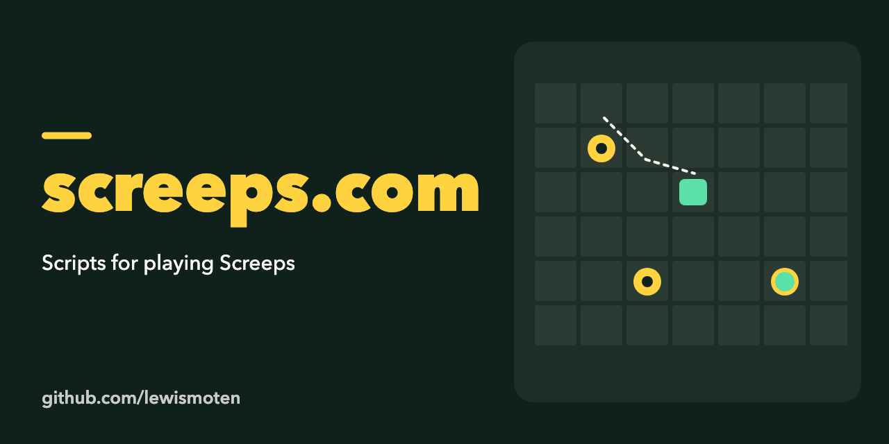

# screeps.com

Scripts for playing [Screeps](https://screeps.com), the game where you write JavaScript to control your colony.

The `default/` folder holds the code for the default branch: `main.js`, shared `helpers.js`, and one module per creep role (harvester, upgrader, builder, fixer, fighter). Copy the files into your Screeps code editor or sync them with a Screeps client.

A 2016 experiment, not maintained.
